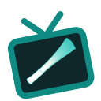
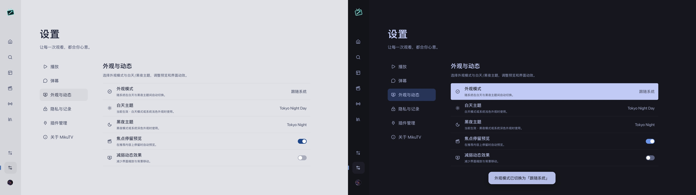
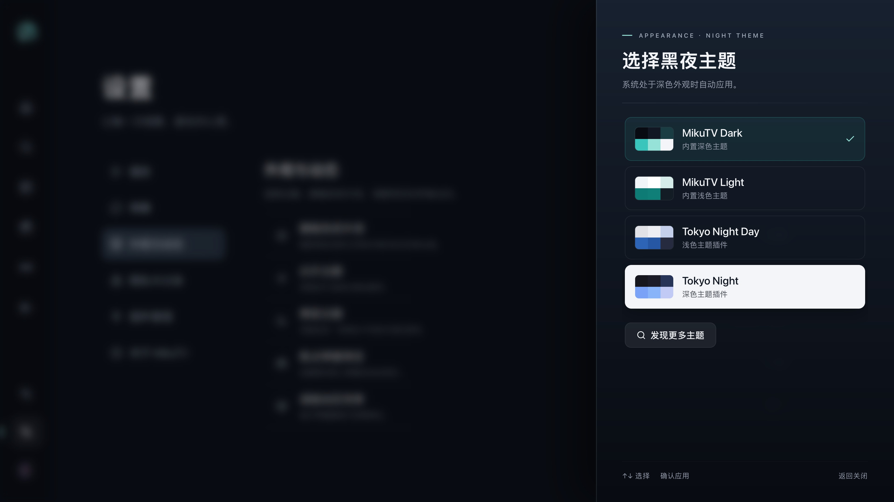
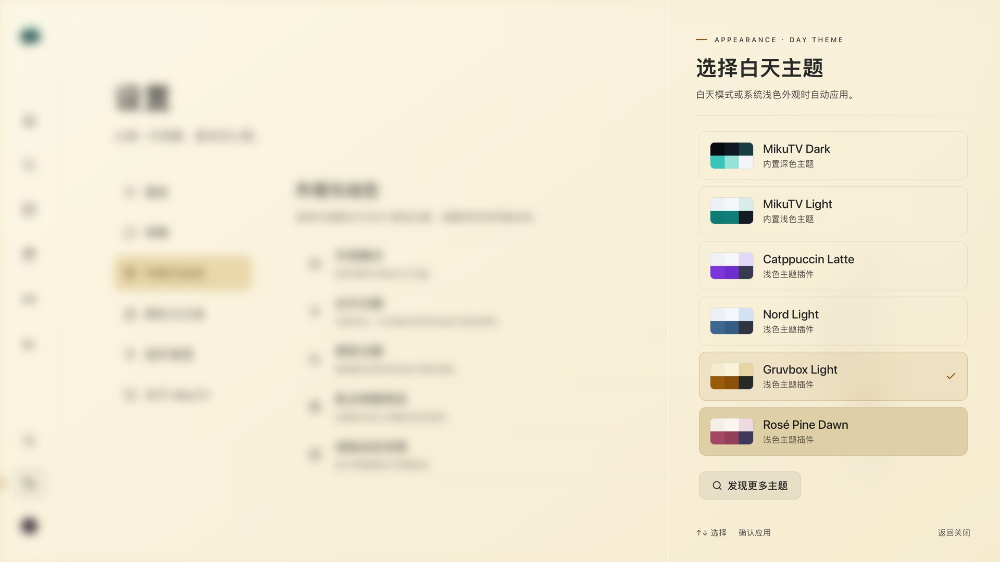
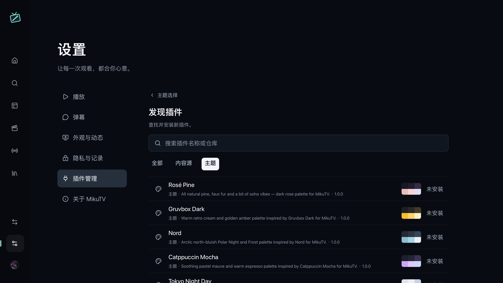

  <picture>
    <source media="(prefers-color-scheme: dark)" srcset="assets/logo-mark-dark.svg" />
    <source media="(prefers-color-scheme: light)" srcset="assets/logo-mark-light.svg" />
    
  </picture>
  <h1>MikuTV</h1>
  
<strong>A native Apple TV video client built around an extensible plugin architecture.</strong>

  
tvOS 18.0+ · Apple TV (arm64) · Apache-2.0

  

    <strong>English</strong> ·
    <a href="README.zh-CN.md">简体中文</a> ·
    <a href="https://mikutv.yuchanns.dev">Website</a> ·
    <a href="docs/install.md">Install Guide</a> ·
    <a href="docs/plugin-development.md">Plugin Development</a> ·
    <a href="https://github.com/yuchanns/MikuTV/releases">Releases</a>
  

https://github.com/user-attachments/assets/f3868d0c-1b14-4be0-ae68-f7bb5268de82

## Highlights

- **Extensible, Sandboxed Plugin Architecture** — Discover and install plugins directly on Apple TV from GitHub (`topic:mikutv-plugin` or `owner/repo`). Every package is verified against its release tag and SHA-256 digest, presents its declared network host allowlist before installation, and runs inside an isolated [`moejs`](https://github.com/MoeForge/moejs) runtime with strict domain enforcement and an 8 KiB per-plugin key-value store.
- **Living-Room First Experience** — Responsive Siri Remote hover-focus navigation, Home Hero hover video auto-preview with audio (without HDMI display-mode black flash), frosted-glass drawers and cinema overlays, virtualized infinite scrolling, hardware-accelerated `AVPlayer` playback with danmaku and subtitle layers, and native tvOS Top Shelf (`PlugIns/TopShelf.appex`).
- **Day & Night Appearance** — Built-in **MikuTV Dark** and **MikuTV Light**, plus 10 official Day/Night theme plugins powered by 46 semantic tokens (`theme.json`). Supports `Follow System`, `Day`, and `Night` modes with independent daytime and nighttime theme slots.
- **Cohesive Native Architecture** — Written in Go to embed the pure-Go [`moejs`](https://github.com/MoeForge/moejs) plugin runtime directly in-process, paired with [`MyGo`](https://github.com/egoist/mygo) (Metal shaders and CoreText) and [`purego`](https://github.com/ebitengine/purego) bindings to `AVFoundation`, `AVKit`, `TVServices`, and Keychain.

  

  
  

  

---

## Documentation

| Guide | What You Will Find |
| --- | --- |
| **[Install & Sideload on Apple TV](docs/install.md)** ([中文](docs/install.zh-CN.md)) | Sideloading comparison (ATVLoadly 7-day auto-refresh, Sideloadly, 1-year cert), Docker/macOS/Windows setup, building from source, and an AI-agent install runbook. |
| **[Plugin Development Guide](docs/plugin-development.md)** ([中文](docs/plugin-development.zh-CN.md)) | Agent-ready reference for authoring, packaging, validating, and publishing MikuTV plugins (`plugin.json`, `moejs` sandbox API, capabilities, themes, and GitHub Releases). |
| **[Plugin Architecture Specification](plans/20261117-init/plugin-architecture.md)** | Deep architectural design notes for the host runtime, sandbox security model, and provider protocol. |

---

## Let Your AI Assistant Help

Both guides above are written so terminal coding agents (Claude Code, Codex, Cursor, Antigravity, etc.) can follow them step by step.

### Install & Auto-Refresh on Apple TV

> Read https://github.com/yuchanns/MikuTV/blob/main/docs/install.md and help me install MikuTV on my Apple TV with automatic 7-day refresh. Detect my host OS, install and start ATVLoadly (`bitxeno/atvloadly`), download the latest `MikuTV-tvOS.ipa` and verify `SHA256SUMS.txt` from `yuchanns/MikuTV` Releases, and pause whenever my manual action is required (Apple TV pairing PIN or Apple ID sign-in).

### Build a MikuTV Plugin

> Read https://github.com/yuchanns/MikuTV/blob/main/docs/plugin-development.md and build a MikuTV plugin for `<describe your content source or theme>`. Follow the exact `plugin.json` manifest, `moejs` sandbox contract, and packaging checklist, validate the resulting `plugin.zip` against MikuTV's Go loader, and prepare a GitHub Release tagged `v1.0.0` with topic `mikutv-plugin`.

---

## Official Theme Plugins

Install directly on Apple TV via **Settings → Appearance & Motion → Discover More Themes** (or **Settings → Plugins → Discover**):

| Palette Family | Night Theme (Dark) | Day Theme (Light) |
| --- | --- | --- |
| **Tokyo Night** | [yuchanns/mikutv-theme-tokyonight](https://github.com/yuchanns/mikutv-theme-tokyonight) | [yuchanns/mikutv-theme-tokyonight-day](https://github.com/yuchanns/mikutv-theme-tokyonight-day) |
| **Catppuccin** | [yuchanns/mikutv-theme-catppuccin-mocha](https://github.com/yuchanns/mikutv-theme-catppuccin-mocha) | [yuchanns/mikutv-theme-catppuccin-latte](https://github.com/yuchanns/mikutv-theme-catppuccin-latte) |
| **Nord** | [yuchanns/mikutv-theme-nord](https://github.com/yuchanns/mikutv-theme-nord) | [yuchanns/mikutv-theme-nord-light](https://github.com/yuchanns/mikutv-theme-nord-light) |
| **Gruvbox** | [yuchanns/mikutv-theme-gruvbox-dark](https://github.com/yuchanns/mikutv-theme-gruvbox-dark) | [yuchanns/mikutv-theme-gruvbox-light](https://github.com/yuchanns/mikutv-theme-gruvbox-light) |
| **Rosé Pine** | [yuchanns/mikutv-theme-rose-pine](https://github.com/yuchanns/mikutv-theme-rose-pine) | [yuchanns/mikutv-theme-rose-pine-dawn](https://github.com/yuchanns/mikutv-theme-rose-pine-dawn) |

---

## Acknowledgments

- **[MyGo](https://github.com/egoist/mygo)** — Go-native Metal & CoreText UI toolkit (with tvOS patches under `patch/mygo/`).
- **[purego](https://github.com/ebitengine/purego)** — Cgo-free Objective-C and Apple framework bindings on `arm64`.
- **[moejs](https://github.com/MoeForge/moejs)** — Pure Go JavaScript runtime powering the plugin sandbox.
- **[Lucide](https://lucide.dev/)** — UI and TV logo base iconography (ISC / MIT, see [`assets/LUCIDE-LICENSE.txt`](assets/LUCIDE-LICENSE.txt)).
- **[OpenClipart / FreeSVG](https://freesvg.org/leek-69352)** — Leek emblem vector artwork (CC0-1.0, see [`assets/LEEK-NOTICE.txt`](assets/LEEK-NOTICE.txt)).
- **[ATVLoadly](https://github.com/bitxeno/atvloadly)** — Open-source Apple TV sideloading and 7-day auto-refresh daemon.

Full third-party Go dependency licenses are generated at build time and viewable in-app under **Settings → About MikuTV**.

## License & Notice

MikuTV is released under the [Apache License 2.0](LICENSE).

MikuTV is an independent, open-source tvOS player shell. It does not bundle, host, or distribute any media content, streams, or third-party service credentials. Community plugins are maintained by their respective authors and installed at the user's discretion.
