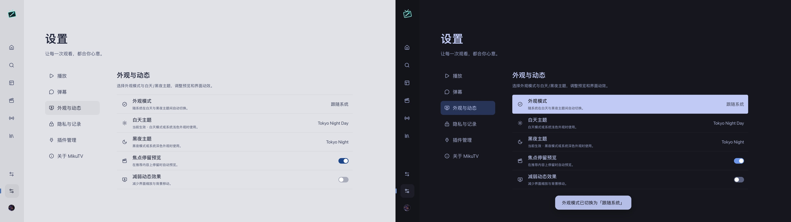
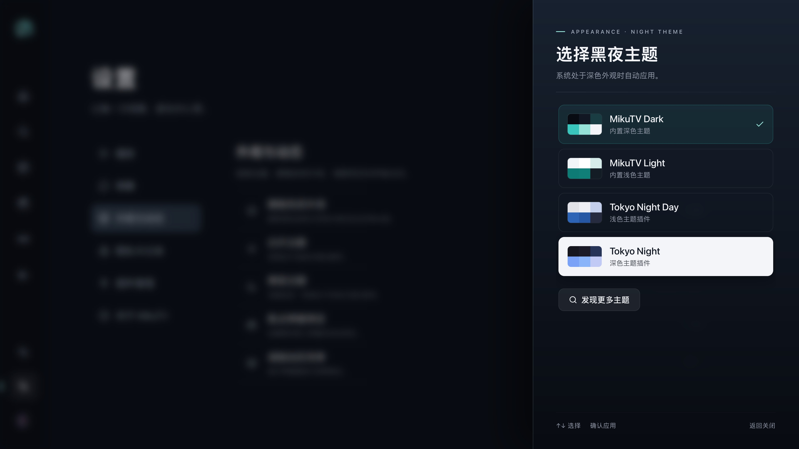
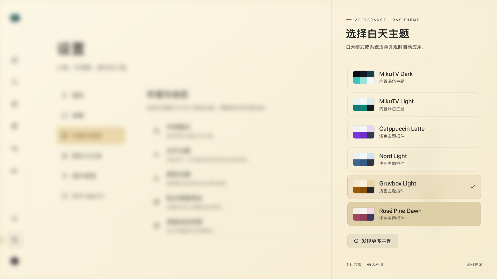
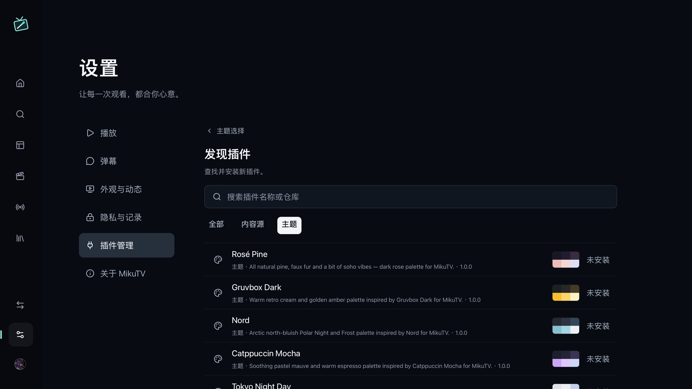

  <picture>
    <source media="(prefers-color-scheme: dark)" srcset="assets/logo-mark-dark.svg" />
    <source media="(prefers-color-scheme: light)" srcset="assets/logo-mark-light.svg" />
    
  </picture>
  <h1>MikuTV</h1>
  
<strong>具备开放可扩展插件架构的原生 Apple TV 视频客户端。</strong>

  
tvOS 18.0+ · Apple TV (arm64) · Apache-2.0

  

    <a href="README.md">English</a> ·
    <strong>简体中文</strong> ·
    <a href="https://mikutv.yuchanns.dev/zh/">官网</a> ·
    <a href="docs/install.zh-CN.md">安装指南</a> ·
    <a href="docs/plugin-development.zh-CN.md">插件开发指南</a> ·
    <a href="https://github.com/yuchanns/MikuTV/releases">Releases 下载</a>
  

https://github.com/user-attachments/assets/f3868d0c-1b14-4be0-ae68-f7bb5268de82

## 核心特性

- **开放可扩展的沙箱插件架构** — 直接在 Apple TV 应用内通过 GitHub（`topic:mikutv-plugin` 或 `owner/repo`）发现并安装插件。每个插件包均校验 Release 标签与 SHA-256 摘要，安装前清晰展示声明的网络域名白名单，并在隔离的 [`moejs`](https://github.com/MoeForge/moejs) 沙箱中运行（严格限制域名访问与 8 KiB 独立存储配额）。
- **为客厅大屏设计的交互体验** — 专为 Siri Remote 打磨的焦点悬停导航、首页 Hero 焦点停留自动播放有声预览（不触发 HDMI 显示模式黑屏闪烁）、毛玻璃抽屉与影院级浮层、虚拟化无限滚动、硬件加速 `AVPlayer` 播放（支持弹幕与字幕图层）以及原生 tvOS Top Shelf（`PlugIns/TopShelf.appex`）。
- **白天 / 黑夜双槽外观** — 内置 **MikuTV Dark** 与 **MikuTV Light**，配套 10 款官方白天 / 黑夜主题插件（46 个语义色彩令牌 `theme.json`），支持「跟随系统 / 白天 / 黑夜」三态切换并独立配置白天与黑夜主题。
- **一体化的原生技术栈** — 选用 Go 将纯 Go 编写的 [`moejs`](https://github.com/MoeForge/moejs) 插件运行时直接嵌入进程内，配合 [`MyGo`](https://github.com/egoist/mygo)（Metal 着色器与 CoreText 排版）和 [`purego`](https://github.com/ebitengine/purego) 直接调用 `AVFoundation`、`AVKit`、`TVServices` 与 Keychain 等系统框架。

  

  
  

  

---

## 文档导航

| 文档 | 内容说明 |
| --- | --- |
| **[Apple TV 安装与签名指南](docs/install.zh-CN.md)**（[English](docs/install.md)） | 侧载方案对比（ATVLoadly 7 天自动续签、Sideloadly、1 年期证书）、macOS / Windows / Docker 部署、源码构建与 AI 助手装机步骤。 |
| **[插件开发指南（面向 Agent 与开发者）](docs/plugin-development.zh-CN.md)**（[English](docs/plugin-development.md)） | 完整的 `plugin.json` 规范、`moejs` 沙箱接口、能力与导出函数映射、主题规范、本地 Go 校验命令与 GitHub Release 发布清单。 |
| **[插件架构设计文档](plans/20261117-init/plugin-architecture.md)** | 插件宿主运行时、沙箱安全模型与 Provider 协议的深入架构设计。 |

---

## 让 AI 助手直接帮你操作

上面的安装指南和插件开发指南均按 **Agent 友好** 结构编写，可以直接交给你的终端 AI 助手（Claude Code、Codex、Cursor、Antigravity 等）按步骤执行。

### 让 AI 帮你装机与自动续签

> 请阅读 https://github.com/yuchanns/MikuTV/blob/main/docs/install.zh-CN.md ，帮我把 MikuTV 安装到 Apple TV 并配置好 7 天自动续签。请先检查我的宿主机环境，帮我安装并启动 ATVLoadly（`bitxeno/atvloadly`），从 `yuchanns/MikuTV` 的 Releases 下载最新 `MikuTV-tvOS.ipa` 并核对 `SHA256SUMS.txt`；遇到需要我本人操作的步骤（Apple TV 配对码或登录 Apple ID）时停下来提示我。

### 让 AI 帮你开发 MikuTV 插件

> 请阅读 https://github.com/yuchanns/MikuTV/blob/main/docs/plugin-development.zh-CN.md ，帮我为「<描述你要接入的内容源或主题>」开发一个 MikuTV 插件。严格遵守其中的 `plugin.json` 清单、`moejs` 沙箱约束与打包清单，用 MikuTV 的 Go 加载器完成校验，并准备好带 `mikutv-plugin` topic 和 `v1.0.0` 标签的 GitHub Release 产物 `plugin.zip`。

---

## 官方主题插件

无需手动下载，在 Apple TV 上打开 **设置 → 外观与动态 → 发现更多主题**（或 **设置 → 插件管理 → 发现插件**）即可一键预览并安装：

| 色彩家族 | 黑夜主题（深色） | 白天主题（浅色） |
| --- | --- | --- |
| **Tokyo Night** | [yuchanns/mikutv-theme-tokyonight](https://github.com/yuchanns/mikutv-theme-tokyonight) | [yuchanns/mikutv-theme-tokyonight-day](https://github.com/yuchanns/mikutv-theme-tokyonight-day) |
| **Catppuccin** | [yuchanns/mikutv-theme-catppuccin-mocha](https://github.com/yuchanns/mikutv-theme-catppuccin-mocha) | [yuchanns/mikutv-theme-catppuccin-latte](https://github.com/yuchanns/mikutv-theme-catppuccin-latte) |
| **Nord** | [yuchanns/mikutv-theme-nord](https://github.com/yuchanns/mikutv-theme-nord) | [yuchanns/mikutv-theme-nord-light](https://github.com/yuchanns/mikutv-theme-nord-light) |
| **Gruvbox** | [yuchanns/mikutv-theme-gruvbox-dark](https://github.com/yuchanns/mikutv-theme-gruvbox-dark) | [yuchanns/mikutv-theme-gruvbox-light](https://github.com/yuchanns/mikutv-theme-gruvbox-light) |
| **Rosé Pine** | [yuchanns/mikutv-theme-rose-pine](https://github.com/yuchanns/mikutv-theme-rose-pine) | [yuchanns/mikutv-theme-rose-pine-dawn](https://github.com/yuchanns/mikutv-theme-rose-pine-dawn) |

---

## 致谢

- **[MyGo](https://github.com/egoist/mygo)** — 纯 Go Metal 与 CoreText 图形框架（tvOS 适配补丁位于 `patch/mygo/`）。
- **[purego](https://github.com/ebitengine/purego)** — 免 cgo 调用 `arm64` Objective-C 与 Apple 系统框架。
- **[moejs](https://github.com/MoeForge/moejs)** — 纯 Go JavaScript 运行时，为插件提供隔离沙箱。
- **[Lucide](https://lucide.dev/)** — 界面与电视图标基础图形（ISC / MIT，见 [`assets/LUCIDE-LICENSE.txt`](assets/LUCIDE-LICENSE.txt)）。
- **[OpenClipart / FreeSVG](https://freesvg.org/leek-69352)** — 大葱徽标矢量图形素材（CC0-1.0，见 [`assets/LEEK-NOTICE.txt`](assets/LEEK-NOTICE.txt)）。
- **[ATVLoadly](https://github.com/bitxeno/atvloadly)** — 开源的 Apple TV 侧载与自动续签工具。

所有第三方 Go 依赖的完整许可文本会在构建时自动打包，可在应用内 **设置 → 关于 MikuTV** 中直接查阅。

## 许可与声明

MikuTV 基于 [Apache License 2.0](LICENSE) 开源。

MikuTV 是一个独立的开源 tvOS 播放宿主，不内置、不托管、也不分发任何视频内容、媒体流或第三方平台凭证。所有社区插件均由各自作者独立维护，并由用户自主决定安装与使用。
